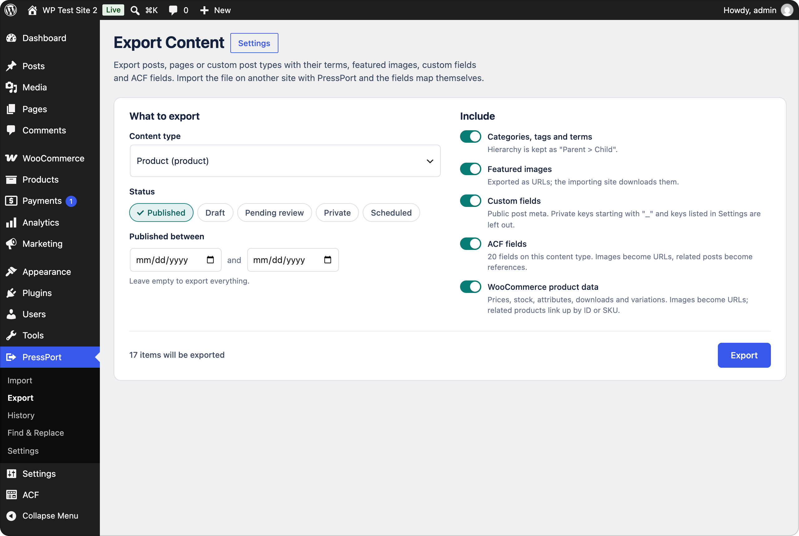
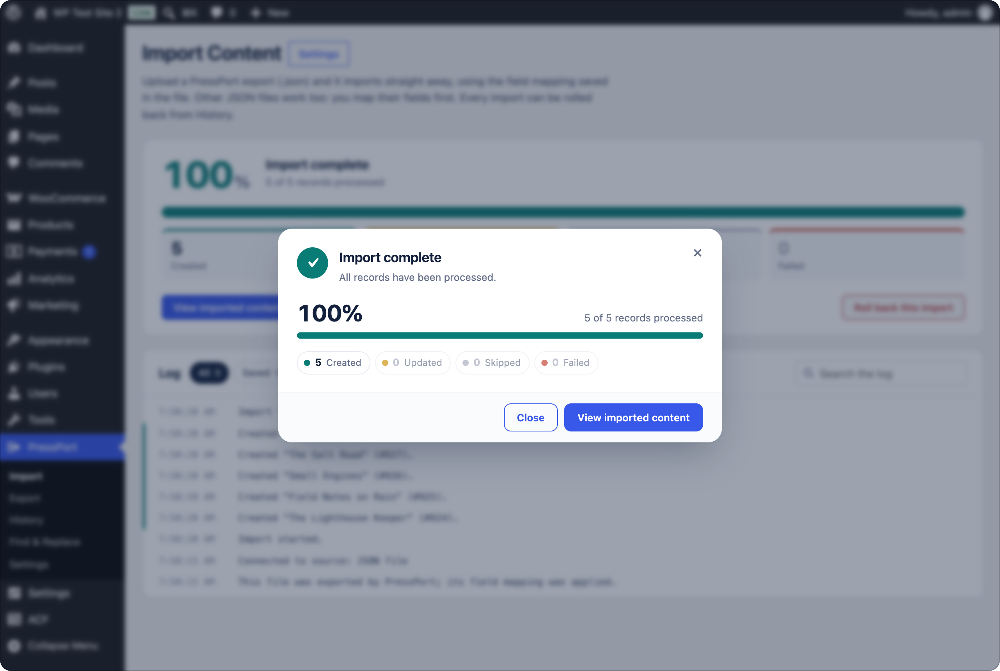

# MigratePlus

> **Not ready for use yet.** MigratePlus is still in development and hasn't had a stable release. Don't run it on a live site until one is published. If you want to try it, use a test site or a copy you can throw away.

A WordPress plugin for moving content between WordPress sites as JSON. Export posts, pages, custom post types and WooCommerce products to a JSON file, then upload that file on another site to import it.

MigratePlus's own exports carry their field mapping and post type, so importing one needs no setup. You can still check the mapping, do a dry run and import in batches. Every import is logged and can be rolled back.

<p align="center">
  
</p>

<p align="center">
  
</p>

## Why MigratePlus

Moving some content from one WordPress site to another is harder than it should be.

WordPress's built-in exporter writes a WXR file, and its importer copies custom fields as they are. ACF fields, though, often store IDs: an image field holds an attachment ID, and a relationship field holds post IDs. Those IDs belong to the old site. On the new one they point at the wrong items or at nothing. WooCommerce products don't come through cleanly either, because prices, stock and variations live in places a plain post import doesn't rebuild.

Full-site migration plugins solve a different problem. They copy the whole site and replace what's on the destination. That's no help when the destination already has its own content and you only want to bring some of it across.

MigratePlus is for that case. Use it to:

- move pages, posts or products from a staging site to the live one without overwriting anything else;
- merge content from one site into another;
- copy a product catalogue between WooCommerce stores, variations included;
- bring JSON from another system into WordPress, mapping its fields to posts, custom fields and ACF.

It downloads images and files into the new site's Media Library and points ACF fields at the new IDs. Products are rebuilt through WooCommerce's own API. Before anything is saved you can do a dry run, and if an import goes wrong you can roll it back from History.

## Features

- **JSON in, JSON out**: export to a JSON file and import by uploading it, compressed as `.json.gz` if the other site's upload limit is low. Other JSON files work too, as long as they hold a list of records; you map their fields by hand once and save the mapping for the next file. You can add other sources with a filter.
- **Field mapping with a preview** of real records. Map title, content, excerpt, date, slug, status, author, categories, tags, featured image, custom fields, custom taxonomies and **ACF fields**.
- **Batched imports** over AJAX, so large imports don't hit PHP timeouts. Includes a progress window with live counts and time remaining, pause/resume and a live log.
- **Dry runs** that show what would be created or updated without saving anything.
- **Safe re-runs**: records are tracked by their source ID, so running an import again can skip or update existing posts instead of duplicating them.
- **Media import**: downloads featured images and, optionally, images inside content, then rewrites the URLs. Each image is downloaded only once.
- **Rollback**: removes the posts, media, comments and menus an import created. Posts it only updated stay, minus any comments it added to them.
- **ACF support**: every field type is converted properly. Image, file and gallery URLs are downloaded; relationships, post objects, taxonomy and user fields are looked up; dates, choices, links and maps are normalised; repeaters, groups and flexible content are rebuilt from nested data or JSON.
- **WooCommerce support**: export and re-import products through WooCommerce's own API, including prices, stock, tax and shipping settings, attributes, downloads and the variations of variable products. Galleries travel as URLs. Up-sells, cross-sells and grouped products are linked by SKU or by their ID on the old site, so products without a SKU link up too.
- **Export** posts, pages or any post type as JSON with terms, featured images, custom fields, ACF fields, WooCommerce product data and, if you want them, approved comments and navigation menus. One file can hold several post types, Media included. The file carries its own mapping and post types, so importing it on another site needs no setup.
- **Find & Replace** across database tables, for example an old domain after a migration. Serialized data stays valid, URLs only match whole (so `http://old.test` leaves `http://old.test.example.com` alone), and a dry run previews every change first.
- **WP-CLI** commands for big or scripted migrations.
- **Settings page** with default import options, access control, download limits and history cleanup.

## Requirements

- WordPress 6.0+
- PHP 7.4+

## Installation

Download `migrateplus-<version>.zip` from the [Releases page](https://github.com/kdbaustert/migrateplus/releases) and upload it under **Plugins → Add New → Upload Plugin**. Or clone it into `wp-content/plugins/`:

```bash
cd wp-content/plugins
git clone https://github.com/kdbaustert/migrateplus.git migrateplus
```

Then activate **MigratePlus** under Plugins. A new **MigratePlus** menu appears in wp-admin.

Install it on both sites: the one you're copying from and the one you're copying to.

## Using it

### Copy content from one site to another

1. On the site you're copying from, open **MigratePlus → Export**. Tick the content types to include (for example Media, Pages and Posts), choose which statuses to include, switch on **Navigation menus** if you want them, and click **Export**. Download the JSON file when it's ready. The link works for 24 hours.
2. On the site you're copying to, open **MigratePlus → Import** and drop the file onto the page.
3. MigratePlus recognises its own export and shows how many items it holds and which site they came from. If some are already on this site, it asks whether to skip them, import them anyway, or review what would change. Confirm, and the import runs in batches with a progress window.
4. Check the result. If something looks wrong, open **MigratePlus → History** and click **Roll back** to delete what the import created.

<p align="center">
  
</p>

<p align="center">
  
</p>

Content that refers to other content links up on its own, in any order, also between post types in the same file. That covers a parent page, a related product and an ACF relationship. If the item being referred to isn't on the site yet, MigratePlus remembers the link and makes it when that item is imported, whether later in the same file or in a later import. One exception: an ACF link inside a repeater or group row needs the import run again once the other item is there.

To check the mapping or do a dry run first, choose **Review mapping** instead of confirming in step 3. A file with several post types doesn't offer it, because the mapping screen works on one post type at a time; do a dry run of such a file with `wp migrateplus import --dry-run`.

### Import JSON from somewhere else

Drop any JSON file that holds a list of records. MigratePlus shows a preview of the first records and suggests a field for the title. Pick a source field for each WordPress field you need (title, content, date, custom fields, ACF fields and so on), run a **Dry run** to see what would be created, then **Start import**.

To skip the mapping next time, give it a name under **Saved mappings** on the same screen and click **Save mapping**. That stores the field mapping and the import options (post type, statuses, what to do with records imported before, images, terms, authors and so on), but not one-off choices such as a dry run or the duplicates you approved. Choose a saved mapping in the select and click **Apply** to use it; any source field it maps that this file doesn't have is left unmapped, and a notice lists them. Rename and Delete sit beside it. Saved mappings are shared by everyone on the site who may run imports.

When you upload a file with the same top-level fields as a saved mapping (in any order; nested lists such as `authors.0.name` don't count), that mapping is selected for you and a notice says so. It isn't applied until you click **Apply**. If several match, the one saved last is selected. MigratePlus exports carry their own mapping and never use saved ones.

### On the command line

For big imports or scripts, the same steps work through WP-CLI:

```bash
wp migrateplus export product --output=products.json   # on the old site
wp migrateplus import json --file=products.json         # on the new site
```

See [WP-CLI](#wp-cli) below for all the options.

## Admin pages

| Page | What it's for |
| --- | --- |
| **MigratePlus → Import** | Drop or choose a JSON file. A MigratePlus export imports after one confirmation; other JSON files go through field mapping, options and an optional dry run first. |
| **MigratePlus → Export** | Export one or more content types as a JSON file, with terms, featured images, custom fields, ACF fields, WooCommerce product data, comments and navigation menus. |
| **MigratePlus → History** | All past imports: view logs, resume, run again, roll back, or delete the record. Tick several records (imports or exports) and click **Delete selected** to delete them in one go; running imports and exports are skipped. Exports are listed below them, each with a log of what went into the file and a download link while the file is kept (24 hours). |
| **MigratePlus → Find & Replace** | Replace text across the site's database tables, with a dry run and sample changes per table (administrators only). |
| **MigratePlus → Settings** | Defaults and plugin-wide options (administrators only). |

### Settings

| Section | Options |
| --- | --- |
| Import defaults | Post type, default status, a status for every item (see Status below), author, handling of previously imported records, batch size, image downloads, creating missing terms and authors, pointing links to the old site at this one (MigratePlus exports only), importing comments, importing menus |
| Export defaults | Statuses and what to include (terms, featured images, custom fields, ACF, WooCommerce, comments, navigation menus) for the Export screen and `wp migrateplus export`; whether to compress the file (`.json.gz`, off by default); custom field keys to leave out, with `*` for a prefix |
| Access | Administrators only, or Editors and Administrators |
| Downloads | Limits for the files an import downloads from the old site (featured images, images in content, Media Library files, WooCommerce download files): timeout per file, never less than 60 seconds; largest image or media file; downloads from localhost, private network addresses and non-standard ports (for migrating from a local dev site). The remote file size limit only applies to custom sources that read their file from a URL |
| Housekeeping | Delete history after N days; remove tracking meta from imported posts on uninstall |

The settings page also includes a quick server check: upload folder, upload limit, PHP time and memory limits, image support and compression (zlib).

## Importing

Drop a `.json` or `.json.gz` file onto **MigratePlus → Import**, or choose one. Its size is limited by your server's upload limit, shown under the drop area; a compressed export is usually several times smaller.

A compressed file is recognised by its first bytes, not its name, so one that lost its `.gz` still works. It is unpacked into MigratePlus's storage folder a chunk at a time and then read like any JSON file. The unpacked JSON may be no larger than PHP's memory limit (1 GB when the memory limit is off), because the import reads the whole file into memory and couldn't handle more anyway; that also stops a file that unpacks into something enormous. Change the limit with the `migrateplus_max_json_size` filter. Compressed files need PHP's zlib extension; without it the import says so, and the Export page doesn't offer compression.

- **A MigratePlus export** is recognised from its header. MigratePlus asks once (how many items, which site they came from, which post type they import as) and then imports straight away with the mapping saved in the file. **Import as** follows the post type it was exported from when this site has that type, so a product export imports as WooCommerce products. Choose **Review mapping** instead to check the fields or run a dry run first.
- **A MigratePlus export with several post types** gets the same single question and imports as one job: Media first, then the other types in the order the file lists them, then its menus. Each item imports as its own type. The progress window shows how far each part has got. One rollback in History removes everything the import created, whatever its type.
- **Any other JSON file** works if it holds a list of records: a top-level array, or a list under a key such as `items`, `data`, `posts` or `results`. You map its fields on the next screen.

Nested fields are flattened with dots, for example `authors.0.name` or `body.value`.

When a real import finishes, MigratePlus rebuilds the permalink rules once (the same as saving **Settings → Permalinks**, without touching `.htaccess`), so the new content doesn't 404 on rules saved before its post type existed.

### Status

**Default status** only fills in for records that have no status, or one MigratePlus doesn't recognise. **Status for every item** overrides each record's status instead: set it to **Draft** to import everything as drafts, for example to review an import on staging. It also applies to posts the import updates. A post set to **Published** whose date is in the future is scheduled for that date, as WordPress does when you publish one by hand. Media keeps its own status.

### Authors

A MigratePlus export names each post's author by email, login and display name. The import looks for a user with that email first, then that login, because the same person often has a different email on each site. If neither matches, it looks up the display name the way MigratePlus always has, as a login, slug, display name or nickname. If there's still no match it creates the author when **Create missing authors** is on, with the exported login, email and display name, and otherwise uses the default author and writes a warning in the log. Exports made before MigratePlus mapped the login and display name are matched as they always were, by the one author value.

### Comments

An export with **Comments** switched on carries each post's approved comments: author name, email and website, date, content, type (comment, pingback, trackback, product review), the comment it replies to, public comment fields (the same keys left out of custom fields are left out here), and the user's email when the commenter had an account. Pending, spam and trashed comments stay behind.

With **Import comments** on (the default), they're added to the imported post with replies under their parents, and a comment whose user's email matches an account on this site is linked to it. Each comment remembers its ID on the old site, so importing the same file again with updating or skipping adds no comment twice; updating a post also updates the comments it brought before. Rolling back an import deletes the comments it added, including those on posts it only updated.

### Menus

An export with **Navigation menus** switched on carries every menu on the site: its name, slug and description, the theme locations it was assigned to, and each item with its title, type (page or post, category or other term, post type archive, custom link), what it points at, its parent item, order, CSS classes, link target, link relationship (XFN), title attribute and description. A page or post is named by its ID, slug and title on the old site, a term by its slug, name and `Parent > Child` path.

With **Import menus** on (the default), the menus are rebuilt after every post in the file:

- An item points at the post imported from the same ID on the old site, or else at a post of that type with the same slug. A term item points at the term with the same path, or else the same slug. An item whose target can't be found is skipped, with a warning in the log; items under it move up to the top level.
- Custom links to the old site point at this one when **Point links to the old site here** is on, as links in content do. Links to files under `wp-content` are left alone.
- A menu with the same slug (or, failing that, the same name) is filled rather than copied, and each item remembers its ID on the old site. Importing the same file again updates those items, or leaves them alone when records imported before are skipped, and adds none twice. Items you added by hand are kept.
- A menu is assigned to a theme location only when the active theme has that location; otherwise the log says so.
- Rolling back the import deletes the menus and items it created and gives each theme location it changed its previous menu back, unless you changed it again since. A menu that was already here keeps its own items.

Menu items only link up to content that is on the site, so export the posts and pages a menu points at in the same file, or import them first. Menus can go with a single post type as well, or on their own: with **Navigation menus** on, an export that matches no content still writes a file when the site has menus, with an empty `items` list. Importing it goes straight to the menus, and its items link to the content already on the site.

### Duplicates

Before an import starts, MigratePlus reads the whole file and looks for items already on this site. An item counts as a duplicate when MigratePlus imported it before from the same source (for a MigratePlus export, the same item from the same site), or when the site already has content of the same type with the same slug. Products also match by SKU, and media by file name. If it finds any, it shows how many and asks:

- **Skip duplicates** imports only the new items.
- **Import anyway** imports everything, so duplicates become copies. Records imported before are still updated if **Records imported before** is set to **Update them**.
- **Review changes** appears when some duplicate posts or pages differ from the version on this site. It lists each one with what would change: the title, content, excerpt, status, publish date, slug and author, with a line-by-line diff for longer text. Only the items you tick are updated; every other duplicate is skipped. Custom fields, terms and images of a ticked item are updated too, and WordPress keeps a revision of the old version. Products are not reviewed this way, because they carry much more than these fields.
- **Media** duplicates are shown side by side: the image on this site and the one in the import, with any title, caption, description or alt text that differs. For each, choose **Skip**, **Update details** (keep this site's file, copy the details) or **Replace image** (swap in the imported file as well, in the same Media Library item, so pages using it show the new image and its URL stays the same when the file type matches) or **Keep both** (add the imported file as a new item and leave this one alone). The imported preview is fetched through this site, so it shows even when your browser can't reach the old site. A replaced file can't be rolled back.

On the command line, `wp migrateplus import` lists the duplicates and the ones that differ, then asks. Pass `--duplicates=skip`, `--duplicates=import` or `--duplicates=update` (update every one that differs, skip the rest) to answer in advance; without a terminal to ask in, it skips them.

## WP-CLI

```bash
# See fields and the mapping
wp migrateplus preview json --file=migrateplus-product.json

# Import
wp migrateplus import json --file=migrateplus-product.json --duplicate=update
wp migrateplus import json --file=feed.json --map=mapping.json --post_type=page --content-images

# Everything from one file (see examples/migration-config.json)
wp migrateplus import --config=migration.json

# Saved mappings (made on the mapping screen)
wp migrateplus import json --file=feed.json --mapping="Books feed"
wp migrateplus mapping list
wp migrateplus mapping export "Books feed" --output=books.json   # a --config file
wp migrateplus import --config=books.json --file=feed.json
wp migrateplus mapping import books.json                         # e.g. on another site
wp migrateplus mapping delete "Books feed"

# Manage imports
wp migrateplus jobs
wp migrateplus resume <job-id>
wp migrateplus rollback <job-id> --yes

# Export
wp migrateplus export page --status=publish,draft --output=pages.json
wp migrateplus export product --after=2024-01-01 --no-meta
wp migrateplus export post --exclude-meta='rank_math_*,old_field'
wp migrateplus export attachment,page,post --menus --output=site.json
wp migrateplus export product --gzip                    # migrateplus-product-<date>.json.gz
```

Options: `--post_type`, `--status`, `--force-status=publish|draft|pending|private|keep` (`keep` uses each record's status), `--author`, `--duplicate=skip|update|create`, `--duplicates=skip|import|update` (see Duplicates above), `--batch_size`, `--[no-]featured-images`, `--content-images`, `--create-authors`, `--[no-]create-terms`, `--[no-]rewrite-links`, `--[no-]comments`, `--[no-]menus`, `--dry-run`, `--mapping=<name>` (a saved mapping; `--config`, `--map` and the flags above override it, and a MigratePlus export refuses it). `--file` takes a `.json` or `.json.gz`. `wp migrateplus export` takes one post type or several separated by commas, and `--[no-]comments`, `--[no-]menus` and `--[no-]gzip` too.

`wp migrateplus mapping export` writes a normal `--config` file (the shape of `examples/migration-config.json`, with `settings` left empty so you pass `--file`), plus `name` and `fields` keys that only `wp migrateplus mapping import` reads. Any option you leave out uses the value from MigratePlus → Settings, except that a MigratePlus export imports into the post type it came from unless you pass `--post_type`.

### Mapping file

```json
{
  "fields": {
    "source_id": "id",
    "post_title": "title",
    "post_content": "content_html",
    "post_date": "date_published",
    "tags": "tags",
    "featured_image": "image"
  },
  "meta": [{ "key": "original_url", "source": "url" }],
  "taxonomies": [{ "taxonomy": "genre", "source": "genres" }],
  "acf": { "hero_image": "image_url", "ingredients": "recipe.ingredients" }
}
```

ACF fields are keyed by field name or key (`field_…`). A source can point at nested data (`recipe.ingredients` collects `recipe.ingredients.0.name`, `recipe.ingredients.1.name`, …) for repeaters, groups, galleries and relationships.

Available fields: `source_id`, `post_type`, `post_title`, `post_content`, `post_excerpt`, `post_date`, `post_name`, `post_status`, `post_author`, `post_author_login`, `post_author_name`, `menu_order`, `comment_status`, `comments` (a list in MigratePlus's export format), `categories`, `tags`, `featured_image`, `featured_image_alt`, and for Media imports `media_url` and `media_alt`.

## Hooks

```php
// Add a source (implement MigratePlus_Source or extend MigratePlus_Source_Base)
add_filter( 'migrateplus_sources', function ( $sources ) {
	$sources['my_cms'] = 'My_CMS_Source';
	return $sources;
} );

// Change or skip a record before it's imported
add_filter( 'migrateplus_record', function ( $record, $job ) {
	if ( empty( $record['title'] ) ) {
		return false;
	}
	return $record;
}, 10, 2 );

// Adjust the wp_insert_post() / wp_update_post() args
add_filter( 'migrateplus_post_data', function ( $postarr, $record, $job ) {
	return $postarr;
}, 10, 3 );

// After each post is saved ($action is "created" or "updated")
add_action( 'migrateplus_after_import_record', function ( $post_id, $record, $job, $action ) {}, 10, 4 );

// Override the capability needed to run imports
add_filter( 'migrateplus_capability', fn () => 'edit_pages' );

// The most JSON a .json.gz upload may unpack to (default: PHP's memory limit, or 1 GB when unlimited)
add_filter( 'migrateplus_max_json_size', fn () => 512 * MB_IN_BYTES );

// Rewrite a remote file URL before it's downloaded (e.g. sign it or add a token)
add_filter( 'migrateplus_remote_file_url', function ( $direct_url, $original_url ) {
	return $direct_url;
}, 10, 2 );

// Custom sources get "Upload file / From URL" on any 'file' setting automatically.
// Opt out with 'remote' => false in the settings schema.
```

## ACF fields

When Advanced Custom Fields (free or Pro) is active, the mapping step lists the ACF fields assigned to the chosen post type, grouped by field group, with suggestions for `acf.<name>`, `meta.<name>` or `<name>` source fields. Values are converted per field type:

| Field type | Accepts |
| --- | --- |
| Image, File | URL (downloaded into the Media Library), a local attachment ID, or `{ "url": … }` |
| Gallery | A list of URLs or IDs, or `"a.jpg\|b.jpg"` |
| Relationship, Post object, Page link | IDs, slugs, titles, URLs, or source IDs of posts imported earlier with MigratePlus |
| Taxonomy | Term names (`Parent > Child`) or IDs; missing terms are created when allowed |
| User | Email, login or ID |
| Select, Checkbox, Radio, Button group | Choice values or labels |
| True / false | `1`, `true`, `yes`, `on` |
| Date, Date time, Time | Any date format |
| Link | URL or `{ url, title, target }` |
| Google Map | `"lat, lng"` or an object |
| Repeater, Group, Flexible content | Nested data or JSON; rows use sub field names (flexible content rows need `acf_fc_layout`) |

A custom field (post meta) row whose key matches an ACF field is saved through ACF too, so the field reference is set correctly. Adjust any value with the `migrateplus_acf_value` filter.

## Export

**MigratePlus → Export** writes posts, pages or any post type to a JSON file you can import with MigratePlus on another site. Tick one content type or several: they all go into one file and are imported in one go. The file starts with a header naming the post types and carrying a field mapping, so the import maps everything automatically.

Switch on **Compress the file (.json.gz)** to download it gzip-compressed, for a site whose upload limit is lower than the export. JSON compresses well, so the file is usually several times smaller. The file is compressed as it is written, in the same last step that builds the plain file, so memory use stays flat however big the export is. MigratePlus on the other site imports it as it is. The switch only shows when PHP has the zlib extension; on the command line it is `--gzip`.

Statuses, the date range and the switches for what to include apply to every type in the file. Media is always written first, whatever order you ticked the types in. That way the import downloads each file once, as a Media item, and the featured images, ACF images and product galleries further down the file reuse it instead of downloading it again.

Choose **Media** to export the Media Library itself: every image and other upload, with its title, caption, description and alt text, and the file as a URL. Importing it downloads each file into the other site's Media Library. A file that an earlier import already brought over (as a featured image, say) is updated, not copied twice, and a rollback leaves it in place. Files sold as WooCommerce downloads are left out, because they belong in the protected folder and travel with the product export. On the command line it is `wp migrateplus export attachment`.

Each item includes the core fields, the author's email, login and display name, terms as `Parent > Child` paths, the featured image URL and alt text, public custom fields, and ACF values in a portable form: images as URLs, related posts as `{ id, slug, title }` references, terms as names, and users as their email and login. On import, a user is matched by email first, then by login, because the same person often has a different email on each site. The original IDs become source IDs, so relationships link up in any order: a post or page that refers to one not imported yet is linked when that one arrives, later in the same file or in a later import. Links inside ACF repeater or group rows are the exception, and need the import run again once the other item is there. Exports run in batches with a progress window and the download link stays valid for 24 hours. Filter items with `migrateplus_export_item`.

Imported posts are tagged with `_migrateplus_job_id`, `_migrateplus_source_id` and `_migrateplus_source_uid`. Imported comments carry `_migrateplus_job_id` and `_migrateplus_source_comment_uid`. Imported menu items carry the same post meta as posts (their source ID is `menu-item:<id>`), and menus an import created carry the term meta `_migrateplus_job_id`.

### File format

```json
{
  "migrateplus": {
    "version": "0.1.0-beta.1",
    "exported": "2026-10-24T10:00:00+00:00",
    "site": "https://old-site.example",
    "post_type": "page",
    "post_types": ["attachment", "page", "post"],
    "counts": { "attachment": 12, "page": 10, "post": 20 },
    "count": 42,
    "mapping": { "fields": {}, "meta": [], "taxonomies": [], "acf": {}, "meta_native": 1 }
  },
  "items": [ { "id": 7, "post_type": "attachment", "title": "…" } ],
  "menus": [ { "id": 3, "name": "Main", "slug": "main", "description": "", "locations": ["primary"], "items": [] } ]
}
```

- `post_types` lists the types in the order they are imported, and `items` holds every item in that order, each with its own `post_type`. `post_type` is only there when the file holds a single type, so a single-type file reads exactly as before.
- `mapping` is one mapping for every type in the file. Media fields (`media_url`, `media_alt`) are only read for Media items and the featured image only for the others; custom fields, taxonomies and ACF fields are only set on items that have them.
- `menus` is only there when menus were exported. Each item has `id`, `title` (empty when it shows its target's title), `type`, `object`, `ref` (`{ id, slug, title, type }` for a post, `{ id, slug, name, path, taxonomy }` for a term, `null` otherwise), `url`, `parent` (the parent item's `id`, 0 for none), `order`, `classes`, `target`, `xfn`, `attr_title` and `description`.
- Files exported before the plugin was renamed from PressPort carry the header under `pressport` instead, and custom fields stored in several rows as `_pressport_rows`. Both still import, and match what they imported before.

Files from before `post_types` existed import as they always have.

## Find & Replace

**MigratePlus → Find & Replace** replaces text in the tables you pick, which by default is every table with this site's prefix. It's meant for things like changing an old domain to the new one after a migration.

- **Dry run** is on by default. It counts the matches per table and shows up to 20 sample changes per table, before and after, without saving anything.
- **Whole URLs only** is on by default. When the search text is a web address or domain, a match has to end where the URL's host or path ends. `http://old.test` is replaced in `http://old.test/page` and `http://old.test:8080`, but not in `http://old.test.example.com` or `http://old.testing.com`. `/blog` doesn't match `/blogging`, and a bare `old.test` doesn't match `sub.old.test`. Text that isn't a URL is matched as plain text.
- **Serialized data** (options, widget settings, many plugins' meta) is unserialized, replaced and serialized again, so string lengths stay correct. Values that are already corrupt are left alone. Objects of classes other than `stdClass` are never loaded: they are kept byte for byte, which also means text inside them is not replaced.
- **GUIDs** in the posts table are left alone unless you turn on "Replace GUIDs".
- MigratePlus's own options (`migrateplus_*`) and tracking meta (`_migrateplus_*`) are skipped, so later imports still recognise content they brought in.
- Tables without a primary key are skipped and listed, because their rows can't be updated safely.

Real runs can be rolled back from **Past replacements** below the form. Before each row is updated, its original values are saved to a private file in `wp-content/uploads/migrateplus/`. Rollback puts them back, but only where a value still holds exactly what the replacement wrote: anything edited since is left alone, and the result says how many values that was. A run that stopped part way can be rolled back too. Deleting a run from the list, the "Keep import history" setting, or uninstalling removes its rollback file, and after that it can't be undone. A database backup before a big run is still a good idea. For WP-CLI, use the built-in `wp search-replace`.

## WooCommerce

When WooCommerce is active, exporting the **product** type also carries the fields WooCommerce keeps in protected meta, which a plain export leaves out: SKU, regular and sale price (with sale dates), tax status and class, stock, weight and dimensions, shipping class, the virtual, downloadable, featured and catalog-visibility settings, downloadable files, and up-sells, cross-sells and grouped children (each as its SKU and its ID on the old site). Attributes travel with their term names, and a variable product brings its variations, each with its own SKU, price, stock and attribute values. A **WooCommerce product data** switch on the Export page turns this off; on the command line it is `--no-woo`.

Import the file on another site with WooCommerce active. It imports as **Products** automatically, and the products are rebuilt through WooCommerce's own API, so prices, stock and attributes end up where WooCommerce expects them. Galleries and variation images travel as URLs and are downloaded when image import is on. Downloadable files are copied too: each file on the old site is downloaded into this site's protected `woocommerce_uploads` folder (the same place WooCommerce's own "Upload file" puts them), so they pass WooCommerce's approved download directories check and keep working after the old site is gone. Files you sell normally sit in the old site's own protected folder, which refuses direct requests, so the export gives each one a private link that serves only that file and stops working after 24 hours. The old site has to be online for the import, and an export older than a day needs running again. A re-import reuses the copies, and rolling back the import removes them. Related products are found by their ID on the old site first, then by SKU. When one isn't on this site yet, the link is made as soon as that product is imported, later in the same file or in a later import. Missing global attributes and their terms are created when **Create missing terms** is on; a variation that already exists (by SKU, or by its attribute combination) is updated rather than duplicated. If WooCommerce is not active on the destination, the product fields are skipped with a warning.

## Notes

- Uploaded and cached source files live in `wp-content/uploads/migrateplus/` (web access denied). They are removed when their history entry is deleted or the plugin is uninstalled.
- Uninstalling removes settings, saved mappings, history and cached files. Imported content is always kept.

## Contributing

Issues and pull requests are welcome at [github.com/kdbaustert/migrateplus](https://github.com/kdbaustert/migrateplus). For anything bigger than a small fix, open an issue first so we can agree on the approach.

You need PHP 7.4 or newer, Composer, and a MySQL or MariaDB server for the tests.

```bash
composer install
```

The checks below run on GitHub Actions for every push and pull request, so run them before you push:

```bash
composer lint     # PHP syntax check
composer phpcs    # WordPress Coding Standards and PHP 7.4 compatibility
composer test     # PHPUnit against a real WordPress install
```

`composer phpcbf` fixes most coding-standards problems automatically.

The tests empty every table in the database they run against, so give them a database of their own. By default they use `migrateplus_tests` on `127.0.0.1` as `root` with password `root`. Set `WP_TESTS_DB_NAME`, `WP_TESTS_DB_HOST`, `WP_TESTS_DB_USER` and `WP_TESTS_DB_PASSWORD` to change that. Create the database once:

```bash
mysql -h 127.0.0.1 -u root -p -e "CREATE DATABASE migrateplus_tests"
```

When you change behaviour, add or update a test in `tests/`. Keep pull requests to one change each, and describe what a user would notice, not only what the code does.

## License

MigratePlus is licensed under the GNU General Public License v3.0.
