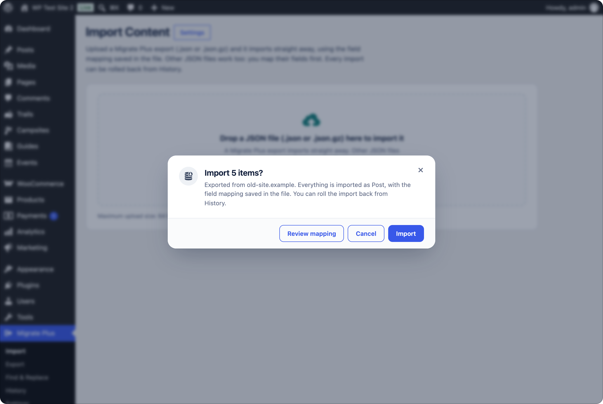
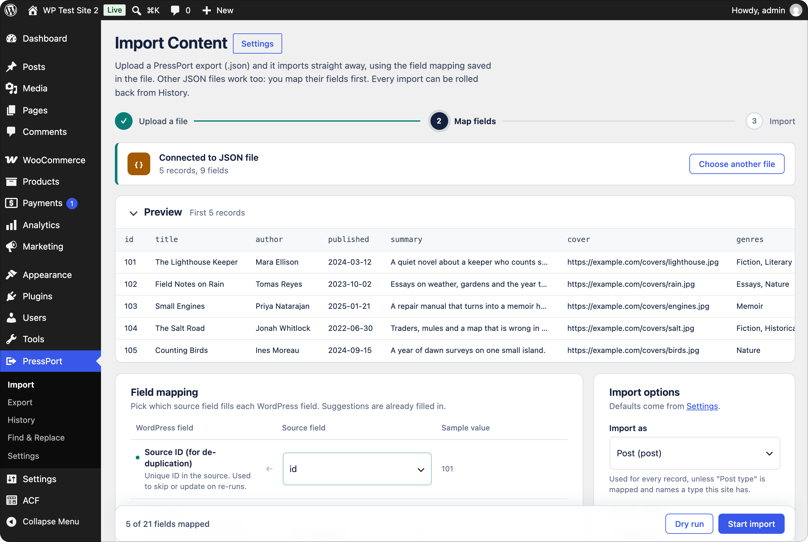

# Migrate Plus

> **Not ready for use yet.** Migrate Plus hasn't had a stable release. Try it on a test site or a copy you can throw away, not a live one.

A WordPress plugin for moving content between sites as JSON. Export posts, pages, custom post types, media, WooCommerce products, comments and menus on one site, then drop the file on another site's Import page.

Migrate Plus exports carry their own field mapping, so importing one takes a single confirmation. Other JSON files work too: you map their fields once and can save the mapping. Every import can be dry-run first and rolled back afterwards.

<p align="center">
  
</p>

## Why

WordPress's own exporter copies custom fields as they are, but ACF fields often hold IDs (an image's attachment ID, a relationship's post IDs) that mean nothing on the new site. WooCommerce prices, stock and variations don't survive a plain post import either. Full-site migration plugins replace the whole destination, which doesn't help when it already has content of its own.

Migrate Plus is for moving *some* content into a site that already exists: staging to live, merging two sites, copying a product catalogue, or bringing in JSON from another system. Images and files are downloaded into the new Media Library, ACF fields point at the new IDs, and products are rebuilt through WooCommerce's API.

## Features

- Export one or several post types into one file, with terms, featured images, custom fields, ACF, WooCommerce data, approved comments and navigation menus. Optionally gzip-compressed. Or hand-pick exactly the posts to export, whatever their type.
- Import with a preview, a dry run, batched progress with pause and resume, and a log.
- Pull content straight from the old site over HTTP, with an application password or a pull key, instead of moving a file by hand.
- Re-imports are safe: records are tracked by their ID on the old site, so they're skipped or updated, not duplicated. Before importing you can review what would change on posts that already exist.
- References link up in any order: parents, related products and ACF relationships are connected when the item they point at arrives, in the same file or a later one.
- Rollback removes what an import created, including comments and menus.
- Saved field mappings for JSON from other systems.
- Find & Replace across the database, with serialized data kept valid, a dry run and rollback.
- WP-CLI commands for everything.

## Requirements

WordPress 6.0+ and PHP 7.4+, on both sites.

## Installation

Download `migrateplus-<version>.zip` from [Releases](https://github.com/kdbaustert/migrateplus/releases) and upload it under **Plugins → Add New → Upload Plugin**, or clone it:

```bash
cd wp-content/plugins
git clone https://github.com/kdbaustert/migrateplus.git migrateplus
```

Activate **Migrate Plus** on the site you're copying from and the one you're copying to.

## Using it

### Copy content between sites

1. On the old site, open **Migrate Plus → Export**, tick the content types (Media, Pages, Posts…), pick statuses, switch on comments or menus if you want them, and click **Export**. The download link works for 24 hours. To export specific posts instead, tick **Hand-picked content** and search by title or paste an ID; picked items are exported whatever their type, and the status and date filters don't apply to them.
2. On the new site, open **Migrate Plus → Import** and drop the file on the page.
3. Confirm. If some items are already on the site, you're asked whether to skip them, import them anyway or review the changes.
4. If something looks wrong, open **Migrate Plus → History** and click **Roll back**.

### Pull from the old site

Instead of moving a file by hand, the Import page can fetch the export itself. Under **Or pull from another site**, enter the old site's address and connect with one of:

- **Application password**: a WordPress user on the old site with an [application password](https://wordpress.org/documentation/article/application-passwords/) (Users → Profile). Needs HTTPS.
- **Pull key**: generated on the **old site** under **Migrate Plus → Settings → Access** ("Generate a pull key on save"). Copy it from there and paste it into the Pull form. It works over plain `http://` too, which application passwords refuse, so it suits local and staging sites without certificates.

Either way the export runs on the old site and streams over; nothing is stored on the pulling site — credentials and key ride along with each request only. Pulls with a key run as the user who generated it. Revoke a key from the same Settings screen.

Pulling from a localhost address, a private network address or a non-standard port also needs the **Local sources** setting (Settings → Downloads) turned on on the pulling site.

### Import JSON from somewhere else

Drop any JSON file holding a list of records (a top-level array, or a list under `items`, `data`, `posts` or `results`). Map a source field to each WordPress field you need, run a **Dry run**, then **Start import**. Nested fields are flattened with dots, like `authors.0.name`.

Save the mapping under a name to reuse it. A later file with the same top-level fields gets it selected automatically; click **Apply** to use it. A site keeps up to 50 saved mappings.

<p align="center">
  
</p>

## Admin pages

| Page | What it's for |
| --- | --- |
| **Import** | Drop or choose a `.json` or `.json.gz` file, or pull one from another site. |
| **Export** | Export one or more content types to a file. |
| **Find & Replace** | Replace text across the database (administrators only; on multisite, network administrators). |
| **History** | Past imports and exports: logs, resume, run again, roll back, delete. Tick several rows to delete them together. |
| **Settings** | Import and export defaults, who can run imports, download limits, history cleanup, and a server check (administrators only). |

## How imports behave

- **Post type.** A Migrate Plus export imports into the type it came from when this site has it. A multi-type file imports Media first, then the other types, then menus, as one job with one rollback.
- **Status.** *Default status* only fills in missing or unknown statuses. *Status for every item* overrides all of them, which is handy for importing everything as drafts on staging. Future-dated posts set to Published are scheduled.
- **Authors.** User accounts differ between sites, so authors aren't taken from the file. Each post goes to the author picked for it (on the mapping step or the duplicates screen), else the *Author for all posts and pages* from the mapping step (`--author` on the command line), else whoever runs the import. A Migrate Plus export skips the mapping step, so its posts go to whoever runs the import unless the duplicates screen picks someone else. The old site's author login and name are kept with the post as a note.
- **Comments.** Only approved comments are exported. They're imported threaded, linked to local users by email, and never added twice.
- **Menus** are rebuilt after the posts. Items point at the imported post or term (or one with the same slug), links to the old site are rewritten, and theme locations are assigned only if the active theme has them. A menu with the same slug is filled rather than copied.
- **Duplicates.** Before starting, Migrate Plus looks for items imported before or with the same slug (SKU for products, file name for media) and asks what to do. Changed posts can be reviewed one by one; duplicate images are shown side by side. A dry run skips duplicates so its counts match a real run.
- **Compressed files** are detected by their bytes, not the extension, and may unpack to at most an eighth of PHP's memory limit (`migrateplus_max_json_size` changes that). They need the zlib extension.
- Permalinks are rebuilt once when an import finishes.

## WP-CLI

```bash
wp migrateplus export page --status=publish,draft --output=pages.json
wp migrateplus export attachment,page,post --menus --comments --gzip
wp migrateplus export --posts=12,34,56
wp migrateplus import json --file=pages.json --duplicate=update
wp migrateplus import json --file=feed.json --map=mapping.json --post_type=page
wp migrateplus import json --file=feed.json --mapping="Books feed" --dry-run
wp migrateplus import --config=examples/migration-config.json
wp migrateplus mapping list|export|import|delete
wp migrateplus jobs
wp migrateplus resume <job-id>
wp migrateplus rollback <job-id> --yes
```

Import flags: `--post_type`, `--status`, `--force-status`, `--author`, `--duplicate=skip|update|create`, `--duplicates=skip|import|update`, `--batch_size`, `--[no-]featured-images`, `--content-images`, `--[no-]create-terms`, `--[no-]rewrite-links`, `--[no-]comments`, `--[no-]menus`, `--dry-run`, `--mapping`. Export also takes `--after`, `--posts` (exactly these IDs, whatever their type; the type list and the status and date filters don't apply), `--exclude-meta`, `--no-meta`, `--no-woo` and `--[no-]gzip`. Anything left out uses the values from Settings.

On/off flags also take a value: `--comments=no`, `--content-images=yes` (yes, no, true, false, 1 or 0). When records are already on the site and `--duplicates` is left out, the import asks; with `--yes`, in a dry run or without a terminal it skips them instead, or imports them as copies if you passed `--duplicate=create`. An import with failed records ends with an error and a non-zero exit status, after the summary, so scripts can catch it. `wp migrateplus resume` only continues imports that were started.

### Mapping file

```json
{
  "fields": { "source_id": "id", "post_title": "title", "post_content": "content_html", "featured_image": "image" },
  "meta": [{ "key": "original_url", "source": "url" }],
  "taxonomies": [{ "taxonomy": "genre", "source": "genres" }],
  "acf": { "hero_image": "image_url", "ingredients": "recipe.ingredients" }
}
```

Fields: `source_id`, `post_type`, `post_title`, `post_content`, `post_excerpt`, `post_date`, `post_name`, `post_status`, `post_author`, `post_author_login`, `post_author_name`, `menu_order`, `comment_status`, `comments`, `categories`, `tags`, `featured_image`, `featured_image_alt`, and `media_url`/`media_alt` for Media.

## ACF

When ACF (free or Pro) is active, the mapping screen lists the post type's fields and converts values by type:

| Field type | Accepts |
| --- | --- |
| Image, File, Gallery | URLs (downloaded), attachment IDs |
| Relationship, Post object, Page link | IDs, slugs, titles, URLs, or old-site IDs of posts imported earlier |
| Taxonomy | Term names (`Parent > Child`) or IDs |
| User | Email, login or ID |
| Choice fields | Values or labels |
| Date, time, true/false, link, map | Any reasonable format |
| Repeater, Group, Flexible content | Nested data or JSON (flexible rows need `acf_fc_layout`) |

Links inside repeater or group rows need the import run again once their target exists.

## WooCommerce

With WooCommerce active, a product export also carries SKU, prices and sale dates, tax and stock settings, dimensions, shipping class, attributes, variations, downloadable files, and up-sells, cross-sells and grouped products (by SKU and old ID). The import rebuilds products through WooCommerce's API. Downloadable files are copied into the protected `woocommerce_uploads` folder through a private link that expires after 24 hours, so import within a day of exporting. Turn product data off with the export switch or `--no-woo`.

## Find & Replace

Replaces text in the tables you choose, for example an old domain after a migration. It starts as a dry run with sample changes per table. URLs only match whole (`http://old.test` leaves `http://old.test.example.com` alone), serialized data stays valid, GUIDs and Migrate Plus's own data are skipped, and tables without a primary key are left out. Real runs can be rolled back from **Past replacements**; values edited since are kept. Back up the database before a big run anyway.

## Hooks

| Hook | Type | Use |
| --- | --- | --- |
| `migrateplus_sources` | filter | Register a custom source class |
| `migrateplus_record` | filter | Change a record before import, or return `false` to skip it |
| `migrateplus_post_data` | filter | Adjust the `wp_insert_post()` arguments |
| `migrateplus_after_import_record` | action | Runs after each post is saved |
| `migrateplus_capability` | filter | Capability needed to run imports |
| `migrateplus_acf_value` | filter | Adjust a converted ACF value |
| `migrateplus_export_item` | filter | Change an exported item |
| `migrateplus_max_json_size` | filter | Most bytes a `.json.gz` may unpack to |
| `migrateplus_remote_file_url` | filter | Rewrite a URL before a custom source downloads it |

## File format

```json
{
  "migrateplus": {
    "version": "0.1.0-beta.1",
    "site": "https://old-site.example",
    "post_types": ["attachment", "page", "post"],
    "count": 42,
    "mapping": { "fields": {}, "meta": [], "taxonomies": [], "acf": {} }
  },
  "items": [{ "id": 7, "post_type": "attachment", "title": "…" }],
  "menus": [{ "id": 3, "name": "Main", "slug": "main", "locations": ["primary"], "items": [] }]
}
```

Items are in import order, Media first. `post_type` appears in the header only when the file holds one type, and `menus` only when menus were exported. Imported content is tagged with `_migrateplus_job_id`, `_migrateplus_source_id` and `_migrateplus_source_uid`.

## Upgrading from PressPort

Migrate Plus used to be called PressPort. The first time the renamed plugin loads it moves settings, history, saved mappings, tracking data and the uploads folder over, so re-imports still recognise earlier content. Files exported under the old name still import. The CLI command is now `wp migrateplus` and hooks start with `migrateplus_`.

## Contributing

Issues and pull requests are welcome at [github.com/kdbaustert/migrateplus](https://github.com/kdbaustert/migrateplus). Open an issue first for anything bigger than a small fix.

You need PHP 7.4+, Composer, Node 22+, and MySQL or MariaDB.

```bash
composer install && npm ci
composer lint && composer phpcs && composer test
npm test
```

The PHP tests empty the database they run in, so give them their own: `migrateplus_tests` on `127.0.0.1` as `root`/`root` by default, or set `WP_TESTS_DB_NAME`, `WP_TESTS_DB_HOST`, `WP_TESTS_DB_USER` and `WP_TESTS_DB_PASSWORD`.

## License

GPL v3.0 or later.
